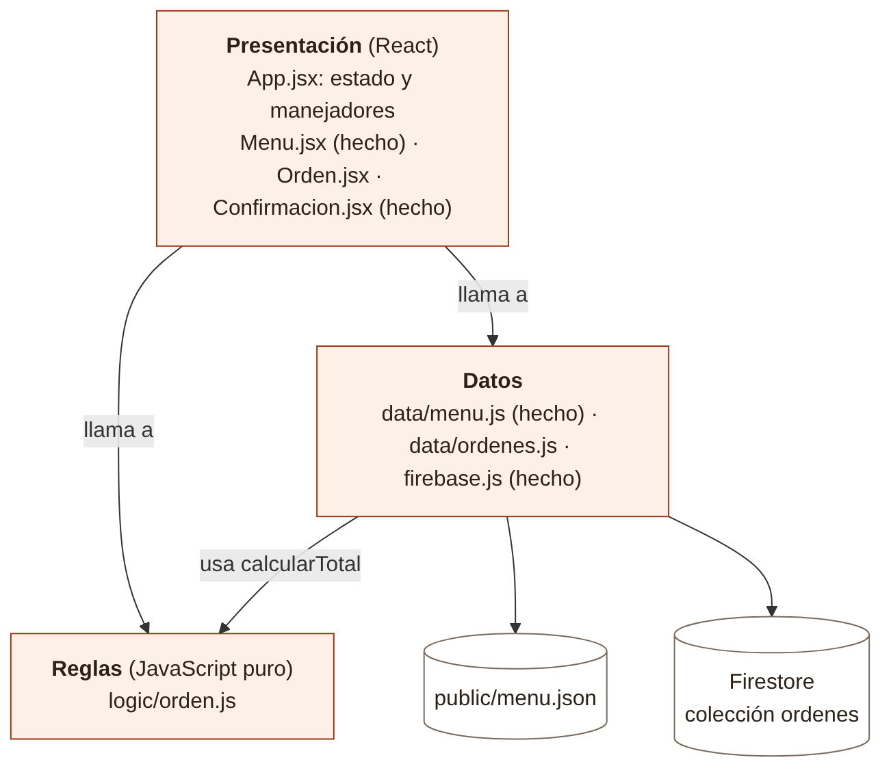
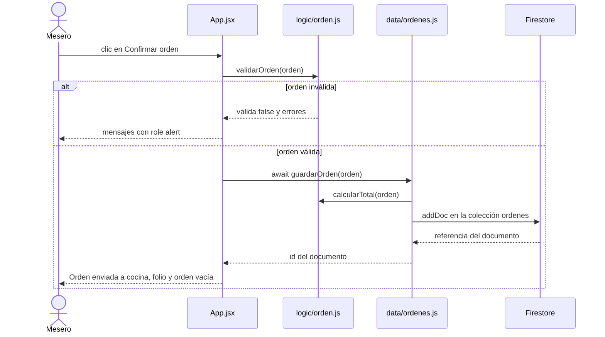

# 05 · Arquitectura

Una aplicación de una sola página en **tres capas**. La regla: **la presentación llama a las reglas y a los datos; las reglas no llaman a nadie.**

*Fuente editable del diagrama: [`diagramas/capas.mmd`](./diagramas/capas.mmd) (Mermaid).*

## Qué hace cada archivo, y qué ya está hecho

| Archivo | Estado | Responsabilidad | **No** puede importar |
| --- | --- | --- | --- |
| `firebase.js` | Hecho | Conexión a Firebase con tu `.env` | — |
| `data/menu.js` | Hecho | `cargarMenu()`: obtiene `/menu.json` | React |
| `data/ordenes.js` | **Te toca** | `guardarOrden(orden)`: escribe en Firestore | React |
| `logic/orden.js` | **Te toca** (2 funciones de modelo ya hechas) | Todas las reglas de la orden | React, Firebase |
| `components/Menu.jsx` | Hecho | Dibuja el menú por categoría. **Es tu modelo para `Orden.jsx`** | `data/`, Firebase |
| `components/Orden.jsx` | **Te toca** | Dibuja la orden, la mesa, el total, los errores y el botón de confirmar | `data/`, Firebase |
| `components/Confirmacion.jsx` | Hecho | Dibuja el aviso de orden enviada con el folio | `data/`, Firebase |
| `App.jsx` | **Te toca** | **Único componente con estado.** Carga el menú, guarda la orden en `useState`, llama a `logic/` y a `data/` | Firebase |

`Menu`, `Orden` y `Confirmacion` son **presentacionales**: reciben datos y funciones por props, no tienen estado y no calculan reglas. Si `Orden` necesita el total, `App` se lo pasa ya calculado con `calcularTotal`.

## Contrato de `logic/orden.js`

Todas regresan una orden **nueva**; ninguna modifica la que recibe (igual que `[...equipo, p]` en la Pokédex).

| Función | Prioridad | Regla |
| --- | --- | --- |
| `crearOrden()` | Hecha | `{ mesa: null, items: [] }` |
| `quitarPlatillo(orden, id)` | Hecha | Saca el item con ese `id` |
| `agregarPlatillo(orden, platillo)` | **Must** | Si no está: entra con `cantidad: 1` y `nota: ''`. Si ya está: `cantidad + 1` |
| `calcularTotal(orden)` | **Must** | Suma de `precio × cantidad`. Orden vacía: `0` |
| `asignarMesa(orden, valor)` | **Must** | Guarda la mesa como **número** (`'5'` → `5`). Vacío o no numérico → `null` |
| `validarOrden(orden)` | **Must** | Regresa `{ valida, errores }`. `errores` incluye `'MESA_INVALIDA'` si la mesa no es un entero de 1 a 20, y `'ORDEN_VACIA'` si no hay items. El texto para la pantalla está en `MENSAJES` |
| `agregarPlatillo` + tope y agotados | Should | No sube de `MAX_POR_PLATILLO` (10). Si `platillo.disponible === false`, regresa la orden sin cambios |
| `cambiarCantidad(orden, id, cantidad)` | Should | `cantidad <= 0` → quita el item. Más de 10 → 10 |
| `ponerNota(orden, id, nota)` | Could | Cambia la nota solo de ese item |

## Contrato de `data/`

| Función | Recibe | Regresa | Nota |
| --- | --- | --- | --- |
| `cargarMenu()` *(hecha)* | — | `Promise<platillo[]>` | Lanza error si la respuesta no es `ok` |
| `guardarOrden(orden)` | `{ mesa, items }` | `Promise<{ id }>` | Arma el documento de `04-modelo-datos.md` y usa `addDoc` |

## Flujo de "Confirmar orden"

*Fuente editable: [`diagramas/confirmar.mmd`](./diagramas/confirmar.mmd).*

**El orden importa (RNF-02):** primero `await guardarOrden(...)`, y solo después se muestra el folio y se vacía la orden. Igual que en la Pokédex: si la escritura falla, la pantalla no miente.
