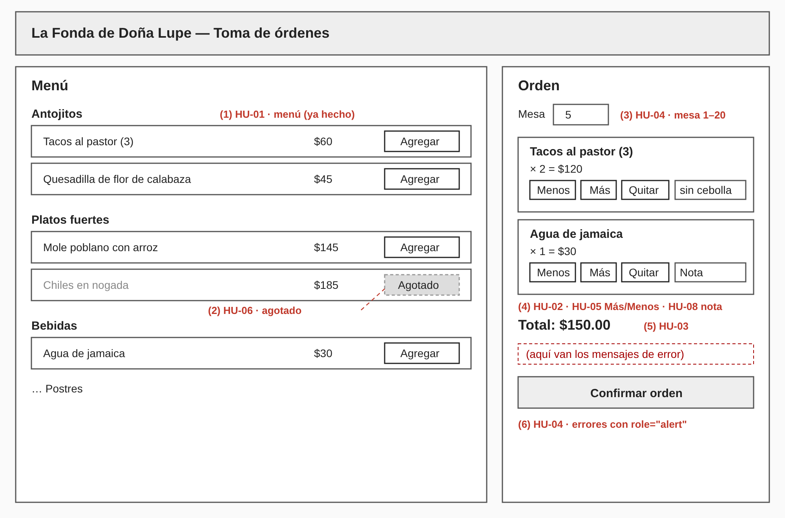
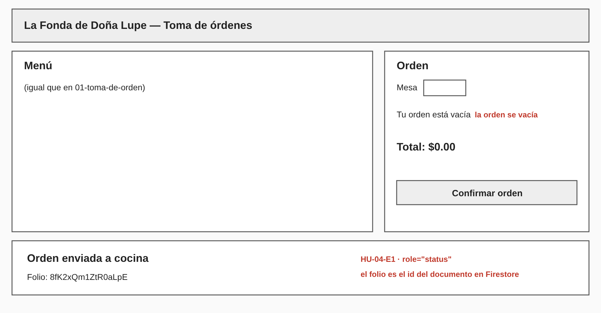

# 07 · Wireframes (baja fidelidad)

Son **bocetos**: definen qué hay en pantalla y dónde, no colores ni tipografía (el estilo ya está en `src/styles.css`). Los números en rojo señalan la historia que resuelve cada elemento. Los textos exactos están en `08-contrato-ui.md`.

## 1. Toma de orden

Menú a la izquierda (ya hecho), orden a la derecha (te toca).

## 2. Orden confirmada

